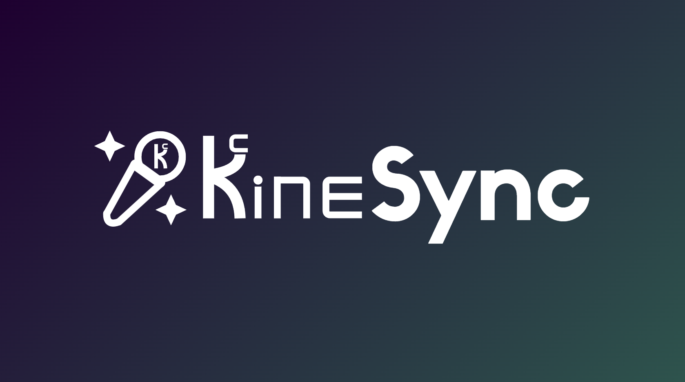
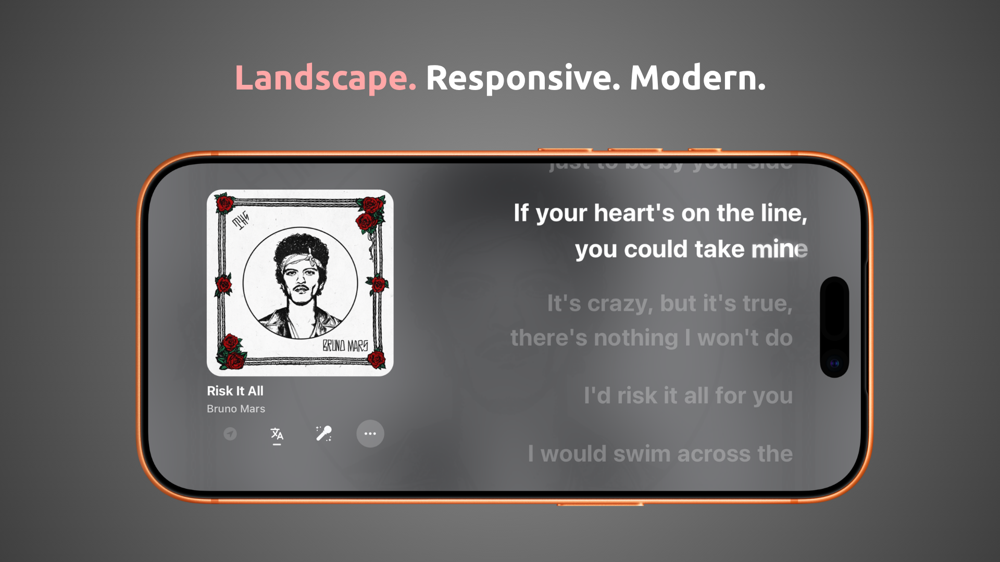

<p align="center">
  
</p>

# KineSync

<p align="center">
  <strong>Beautiful Lyrics For Every Phone</strong><br>
  Karaoke lyrics automatically fetched from your Spotify playback. 100% free for both iOS and Android, and it doesn't require Premium.
</p>

<p align="center">
  
  
  
  
</p>

<p align="center">
  <a href="https://kineticron.github.io/KineSync/">Website</a> ·
  <a href="#install">Install</a> ·
  <a href="docs/README.md">Documentation</a> ·
  <a href="CONTRIBUTING.md">Contribute</a> ·
  <a href="https://github.com/Kineticron/KineSync/releases/latest">Releases</a> ·
  <a href="https://github.com/Kineticron/KineSync/issues/new/choose">Report a bug</a>
</p>

> [!TIP]
> **Start with your phone.** Choose **Use this phone only** during onboarding. Add a Desktop Bridge later to manage your lyrics more effectively.

## Features

**New in v1.2.0: Native Renderer Rework.** Spicy and AMLL now render natively by default on iOS and Android, with Skia lyric drawing, animated interludes, and reworked scrolling. See the [release notes](https://github.com/Kineticron/KineSync/releases/tag/v1.2.0) for changes and current limitations.

- **Phone-only playback:** sign in to Spotify and play through KineSync's embedded Spotify browser. A computer is optional and allows you to manage and own your lyrics efficiently.
- **Spicy and AMLL lyric styles:** full Spicy Lyrics and Apple Music feature parity.
- **Get Karaoke Lyrics:** Spicy Lyrics, Musixmatch, QQ Music, NetEase, Kugou, LRCLIB, and a local lyrics vault mean you get syllable-level sync for almost every song.
- **Lyrics vault:** import, archive, and export TTMLs to own and manage your lyrics.
- **Artwork and layouts:** animated artwork straight from Apple Music and portrait and landscape views
- **Optional translation:** translate lyrics with a configured Gemini API key and choose your language. Save translations too.
- **Desktop Bridge:** follow desktop Spotify over a local connection or an optional secure relay.

<details>
<summary><strong>Preview the player</strong> · Portrait and landscape</summary>

<p align="center">
  
</p>
<p align="center">
  
</p>

</details>

## Install

| Platform                  | Download                                                                                                                | Instructions                                                                |
| ------------------------- | ----------------------------------------------------------------------------------------------------------------------- | --------------------------------------------------------------------------- |
| Android                   | [Signed APK](https://github.com/Kineticron/KineSync/releases/latest/download/KineSync-Android.apk)                      | [Android installation](ANDROID_INSTALL.md)                                  |
| iPhone / iPad             | [Unsigned IPA](https://github.com/Kineticron/KineSync/releases/latest/download/KineSync-iOS-unsigned.ipa)               | [iOS installation and sideloading](IOS_INSTALL.md)                          |
| Windows bridge (optional) | [Desktop installer](https://github.com/Kineticron/KineSync/releases/latest/download/KineSync-Desktop-Windows-Setup.exe) | [Bridge setup](SETUP.md#method-2-windows-installer-optional-desktop-bridge) |
| Docker bridge (optional)  | [Setup bundle](https://github.com/Kineticron/KineSync/releases/latest/download/kinesync-docker-setup.zip)               | [Docker setup](DOCKER.md)                                                   |

Start with **Use this phone only** during onboarding. Sign in with a Spotify email address and password. Google and Apple sign-in are unavailable in the embedded browser. To follow desktop playback instead, choose **Use a Desktop Bridge** and scan the bridge's pairing QR code.

The bridge's native installer supports Windows. Its Docker deployment supports `amd64` hosts on Windows, macOS, and Linux. See the installation guides for checksums, signing requirements, and troubleshooting.

## Status and limitations

> [!NOTE]
> **The lyric source sets the detail.** Word timing, background vocals, and duet alignment depend on the data available for the exact recording.

KineSync is community-maintained and is not affiliated with Spotify, Apple, or the lyric providers. Playback capabilities depend on Spotify's account and client restrictions. Lyric availability and timing depend on the recording and provider. Interpolated line lyrics are not equivalent to provider-supplied word timings.

Android and iOS are the primary targets. Web support is experimental. iOS installation requires sideloading. Free-account signatures need periodic renewal. The current iOS Live Activity shows playback metadata, not advancing lyric text since Live Activity updates require a paid Apple Developer account.

The mobile app uses Expo SDK 58 and a React Native release candidate. Native changes require a development or release build. Expo Go cannot validate every feature. Compare performance using matching release builds on the same device. [Recorded performance results](ExpoLyrics/docs/performance-results.md) distinguish microbenchmarks from app FPS and battery measurements.

## Development

<details>
<summary><strong>Set up a local checkout</strong> · Node.js 22 and npm</summary>

Use Node.js 22 and npm with the committed lockfiles. From the repository root:

```sh
cd ExpoLyrics
npm ci
npm start
```

For desktop development, open a separate terminal:

```sh
cd DesktopBridge
npm ci
npm start
```

Windows installs attempt to download verified native binaries for the matching release. Building them locally requires Visual Studio's C++ tools and .NET 9. [SETUP.md](SETUP.md) covers native app builds, pairing, and remote access. [CONTRIBUTING.md](CONTRIBUTING.md) lists the checks to run before a pull request.

</details>

## Project layout

| Directory                                | Purpose                                                                |
| ---------------------------------------- | ---------------------------------------------------------------------- |
| [ExpoLyrics](ExpoLyrics/README.md)       | Expo / React Native mobile app and WebView lyric hosts                 |
| [DesktopBridge](DesktopBridge/README.md) | Electron bridge, lyric providers, relay, and native playback helpers   |
| [docs](docs/README.md)                   | Architecture, provider configuration, and maintainer guidance          |
| [scripts](scripts/)                      | Repository checks, release publishing, and Docker setup                |
| [.github](.github/)                      | Contribution templates, dependency updates, and CI / release workflows |

## Contributing and support

Bug fixes, documentation, accessibility work, translations, and reproducible performance reports are welcome. Read [CONTRIBUTING.md](CONTRIBUTING.md) before participating. Use [GitHub issues](https://github.com/Kineticron/KineSync/issues) for troubleshooting and [SECURITY.md](SECURITY.md) for private vulnerability reports.

## License and acknowledgements

The Desktop Bridge is **GPL-3.0-only** under [LICENSE](LICENSE). The mobile app is **AGPL-3.0-only** under [ExpoLyrics/LICENSE](ExpoLyrics/LICENSE), consistent with its package metadata and incorporated lyric renderers. Third-party code keeps its own license and attribution. See [THIRD_PARTY_NOTICES.md](THIRD_PARTY_NOTICES.md).

KineSync incorporates work from [Spicy Lyrics](https://github.com/Spikerko/spicy-lyrics) and [Apple Music-like Lyrics](https://github.com/amll-dev/applemusic-like-lyrics), and uses Expo, React Native, Electron, and the lyric providers listed in the documentation. Software licensing does not grant rights to provider-hosted lyrics, artwork, or services. See [provider configuration and restrictions](docs/lyrics-sources.md).
