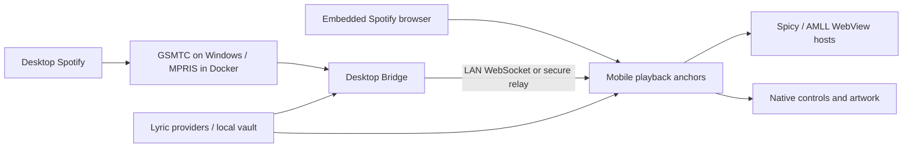

# Architecture

[← Documentation](README.md) · [Contributing](../CONTRIBUTING.md)

<strong>Two playback paths. One lyric screen.</strong>

KineSync has a mobile app and an optional Desktop Bridge. Both can resolve lyrics. The bridge is not required for phone-only playback.

## Playback and rendering

> [!NOTE]
> **Separate clocks have separate jobs.** Diagnostic updates, native controls, and lyric animation do not need the same update frequency.

The mobile playback store accepts packets from the selected playback mode and maintains position/time anchors. Native controls use a UI-thread clock, and lyric hosts project anchors in their own rendering runtime. Background and hidden views suspend animation work. A diagnostic store tick is separate from display-rate rendering.

Both lyric styles currently render through WebViews. Spicy adapts an upstream word/letter animation runtime. AMLL wraps `@applemusic-like-lyrics/core`. Their generated JavaScript and CSS bundles are tracked for reproducible app packaging. [Renderer notes](../ExpoLyrics/docs/lyrics-renderers.md) describe scrolling, synchronization, and regeneration.

## Lyric lookup and storage

Desktop provider code is split into ordered parts loaded into one VM context. The mobile service is a portable bundled copy with runtime adapters. Provider changes need to stay aligned in both implementations. Provider availability, recording matching, timing tier, and local vault entries affect the selected result. The vault preserves original TTML and metadata where available. The software license does not change provider content restrictions.

The native mobile vault uses `expo-sqlite`, the Electron bridge uses Node's built-in `node:sqlite` in its bundled Node 24 runtime. Each device owns a local database with WAL journaling, indexed song identifiers, and transactional writes. Catalog queries load summaries, full lyric payloads are fetched only when needed. Preferences and credentials keep their existing storage.

On first use, the mobile database imports the previous AsyncStorage vault, and the desktop database imports legacy manifests and JSON/gzip lyric files. Entries and the completion marker commit in one transaction, failed migrations retry without deleting the original data. These legacy values/files remain recovery backups, not active stores. Original TTML documents, translations, credits, expiry metadata and vault IDs survive migration. Native vault storage no longer has the previous 100-song or whole-vault JSON-size cap. Experimental web retains its existing browser-storage adapter so it does not require cross-origin isolation headers.

TTML imports use embedded AMLL `spotifyId`/`spotifyTrackId` metadata when present. Otherwise the import path searches Spotify's partner endpoint using the existing web-session token, with strict artist/recording checks and ambiguity rejection. Import searches skip traditional Web API enrichment and do not treat the final lyric timestamp as the recording duration. Offline imports, unavailable sessions and uncertain matches still save using metadata lookup. The file's identity takes precedence over unrelated now-playing metadata.

Adding `expo-sqlite` requires a new Android/iOS development or release binary, an OTA JavaScript update alone cannot install the native module. The vault UI and TTML import/export flows are unchanged.

## Native and container boundaries

The Windows bridge uses a C++ GSMTC watcher and a .NET seek helper. Docker uses Spotify's Linux client with MPRIS and D-Bus, exposing windows through Xpra. Generated Expo projects are ignored. Config plugins, native module sources, and widget sources are tracked. The iOS Live Activity publishes playback metadata and does not provide an independent background lyrics service.

Bridge credentials, Spotify sessions, and user API keys belong in local configuration or secure storage. Do not include them in fixtures or diagnostics. See [SECURITY.md](../SECURITY.md).
