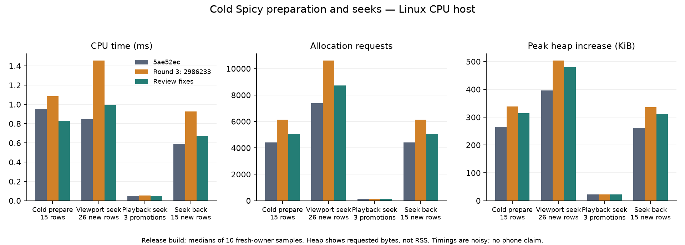

# Round 3 independent-review follow-up

Work stayed in `rust-renderer-spike`; no main/dev, Skia, WebView or native
`src/main.rs` edits. This report supersedes the round-3 handoff's verification
claims where the review found inadequate coverage.

## Status per finding

1. **AMLL dot row opacity fixed.** `native-lyric-row.tsx` puts the interlude
   inside the animated parent row. During visual priming that row fades from
   1 to 0.85 over 400 ms using bezier(0.25,0.1,0.25,1). Dot coverage now includes
   `RowState.outer`. A dot-only GPU comparison at 5540 and 5600 ms checks both
   the source-driven expected pixels and the summed alpha ratio with/without
   the parent opacity (0.015 tolerance for pixel quantization).

2. **Exact Spicy glyph-mask shadow remains unimplemented.** The sharp bullet
   is the actual bundled SF Pro Display Bold glyph. Its shadow still comes
   from a rounded rectangle around measured ink bounds; this is explicitly
   an approximation and is NOT Skia parity.

   Precise backend limitation: locked Vello 0.12 `Scene` supports glyph draws,
   clipping/luminance layers and `draw_blurred_rounded_rect[_in]`. It exposes
   no arbitrary glyph-mask Gaussian filter. The existing `gpu::Filter` reads
   the entire shared scene and supplies only two fixed Gaussian bases (2.5
   and 6 logical pixels); neither can isolate one bullet nor reproduce its
   continuous `(4 + 6*glow)/2` sigma. Clipping a blurred rectangle to a glyph
   would also be wrong: it removes the shadow outside the glyph.

   A true implementation needs an isolated glyph-mask render target, an
   adjustable Gaussian convolution and composition under the sharp bullet,
   with group opacity applied after combining them. Those resources/passes
   must be allocated outside frames and independently budgeted. That renderer
   feature was not implemented here. This is a remaining implementation gap,
   not a claim that glyph-mask blur is impossible in Rust. No exact shadow
   parity or phone acceptance is claimed.

3. **Lifecycle/reference checks replaced.** The old test prepared detailed
   geometry before taking its baseline. Its replacement starts with row 3
   already shaped but `detailed=false`, `timed=None`, and no appearance owner.
   The real `prepare(999) -> prepare(1000)` window transition promotes it.
   Assertions check that preparation count increases, timing is populated,
   the same paragraph layout is retained, and the first four prepared frames
   match its cold pixels exactly. Both styles, play/pause, bottom clipping
   and shared blur paths are covered. Other rows are moved outside the scene
   so intentional cue changes cannot contaminate the subject's blur input.

   The dot test now renders ONLY dots, away from edge fades. Expected scalar
   receipts are generated by executing the unchanged TypeScript Skia timing
   modules, with source SHA256 checks. It compares dot-region pixels and
   scale/Y/glow/opacity parameters through entry, breathing, priming and exit.
   Spicy's expected image deliberately uses the same documented approximate
   shadow; it is a timing/placement/alpha check, not a Skia shadow-pixel oracle.
   Regenerate receipts with `node scripts/interlude-reference.cjs` from the
   renderer directory.

4. **Both reported failures reproduced on clean 5ae52ec.** An exported source
   snapshot was rebuilt before running the two failing tests, not checked out
   over the worktree. The baseline tests report 73 filtered tests, confirming
   the baseline binary rather than the later 80-test binary. Production
   source hashes are in `baseline-source-hashes.json`. Benchmark experiments
   later injected only the identical test allocator/probe into that export.

   - Subtitle: the old test crops at `height*0.37`, the obsolete generic
     anchor. Actual styled rendering uses `scroll_anchor()`, row prefix,
     current scroll, interlude shift, row top and voice offsets/padding.
     Correcting the test's region makes all four subtitle style/orientation
     cases pass. This was a pre-existing test-coordinate error, not missing
     subtitle ink or a round-3 rendering regression.
   - Appearance budget: clean baseline and follow-up both fail the same four
     Baseline -> Fill scene CPU gates. The test compares two effect stacks
     WITHIN each revision, not round 3 against 5ae52ec. The Fill scene costs
     approximately twice the baseline scene in this debug llvmpipe run. The
     subsequent Motion/Glow comparisons pass. Thresholds remain unchanged;
     this budget failure has NOT been fixed or waived. The legacy report
     falsely labeled every build "release opt3"; new reports record the real
     build (`debug` for the full ignored-suite run).

5. **Cold preparation and seeks measured; residual cost reported below.**
   Removed a redundant `DotGlyph::prepare` for every eager scratch row; only
   the owning lazy track needs that glyph. Temporary Spicy timed geometry
   and retained idle scenes still add cold allocations/memory over baseline.

6. **Ghost remains unreproduced, not fixed.** The existing orientation/clear
   and two-frames-in-flight GPU tests pass. They do not establish the cause
   of a one-off upside-down/mirrored phone line. Another iPhone/Metal test is
   necessary.

## Validation

- `cargo +1.97.0 fmt --check`: pass.
- `cargo +1.97.0 clippy --locked --all-targets -- -D warnings`: pass.
- `cargo +1.97.0 test --locked`: 69 pass, 12 ignored, zero regular failures.
- `cargo +1.97.0 test --locked --lib -- --ignored --test-threads=1`:
  **11 pass, 1 FAIL**, 165.33 seconds, debug llvmpipe. This is 10/11 GPU tests
  passing plus the new CPU cold probe passing. Sole remaining failure:
  `appearance_tests::live_effect_interleaved_budget`.
- The cold release probe passed independently for all three source revisions.
- Existing warm scene allocation assertions, including interlude rendering,
  still pass at zero. They do not imply cold preparation is allocation-free.

Raw full-suite output: `followup-all-ignored.txt`. Baseline failure logs:
`baseline-budget.txt` and `baseline-subtitle.txt`. Compact per-effect receipts:
`baseline-budget.json`, `independent-original-budget.json`,
`followup-budget.json`. The original complete timing samples remain in
`/tmp/review-original-rust-parity-appearance-budget.json`; baseline and
follow-up full samples are `/tmp/round3-baseline-budget.json` and
`/tmp/round3-followup-budget.json`.

## Cold Spicy cost

Linux CPU release build; 200 copies of actual fixture line 11 at 390x640;
10 fresh font contexts/track owners per revision. Parsing and font registration
are excluded. Construction includes the input clone. Each owner then runs cold
playback preparation, a distant cold viewport preparation, a playback seek
into that viewport, and a seek back to the retired original rows.

Thread-local allocator measurements count allocations/reallocations and
requested bytes, not RSS. Peak/delta are relative to each operation's existing
live heap; retirement can make net deltas negative. This is cold-owner data
inside one process, not first app launch or phone timing. Runs were serial by
revision rather than statistically interleaved, and sub-millisecond CPU timing
is noisy: do not infer a speedup over baseline from these medians.

| Operation | Revision | Median ms | Requests | Requested KiB | Peak increase KiB | Net heap delta KiB |
|---|---|---:|---:|---:|---:|---:|
| Construct | 5ae52ec | 0.254 | 8808 | 653.9 | 555.9 | 555.9 |
| Construct | 2986233 | 0.502 | 8887 | 748.0 | 634.9 | 614.3 |
| Construct | Review fixes | 0.497 | 8887 | 748.0 | 634.9 | 614.3 |
| Cold prepare (15 rows) | 5ae52ec | 0.951 | 4412 | 930.2 | 265.3 | 236.8 |
| Cold prepare (15 rows) | 2986233 | 1.085 | 6146 | 1644.8 | 338.7 | 282.3 |
| Cold prepare (15 rows) | Review fixes | 0.832 | 5066 | 1110.8 | 314.4 | 282.3 |
| Cold viewport seek (26 new rows) | 5ae52ec | 0.848 | 7384 | 1555.7 | 396.1 | 367.5 |
| Cold viewport seek (26 new rows) | 2986233 | 1.455 | 10608 | 2841.4 | 503.4 | 447.1 |
| Cold viewport seek (26 new rows) | Review fixes | 0.993 | 8736 | 1915.8 | 479.2 | 447.1 |
| Playback seek (3 promotions) | 5ae52ec | 0.052 | 138 | 28.6 | 22.3 | -212.0 |
| Playback seek (3 promotions) | 2986233 | 0.053 | 138 | 28.6 | 22.3 | -257.9 |
| Playback seek (3 promotions) | Review fixes | 0.051 | 138 | 28.6 | 22.3 | -257.9 |
| Seek back (15 new rows) | 5ae52ec | 0.589 | 4398 | 926.1 | 262.0 | -155.5 |
| Seek back (15 new rows) | 2986233 | 0.927 | 6135 | 1641.0 | 335.7 | -189.2 |
| Seek back (15 new rows) | Review fixes | 0.672 | 5055 | 1107.1 | 311.4 | -189.2 |

The scratch-bullet fix removes 1,080 cold-prepare allocation requests and 1,872
cold viewport allocation requests relative to original round 3. Relative to
5ae52ec, the follow-up still adds 654 cold-prepare requests and 1,352 cold
viewport requests. The viewport operation retains about 80 KiB more heap than
baseline across its 26 new rows; that remaining cost comes from the prepared
Spicy idle glyph scenes. Playback promotion into those already shaped rows
still requests 138 allocations/28.6 KiB on all three revisions.

Full measurements and scope: `cold-preparation.json`; release build/probe logs:
`cold-baseline.txt`, `cold-round3.txt`, `cold-followup.txt`. The probe source is
`src/cold_prepare_tests.rs`; set `RUST_COLD_REPORT` to choose its JSON path.

## Commits and push

- `7e944d6`: remove scratch-row bullet shaping and add cold heap/time probe.
- `b5f3b0a`: apply AMLL parent opacity, isolated reference-driven dot checks,
  and explicit shadow limitation in the draw code.
- `a34d6f9`: genuine plain-to-detailed promotion lifecycle regression.
- `eb65442`: correct subtitle region, remove the inadequate old lifecycle
  check, and label budget reports with their real build.

All commits use Kineticron <kineticrondev@gmail.com>, with no AI trailers.
Push outcome is reported in the final response; only rust-renderer-spike is
authorized as a push target.
